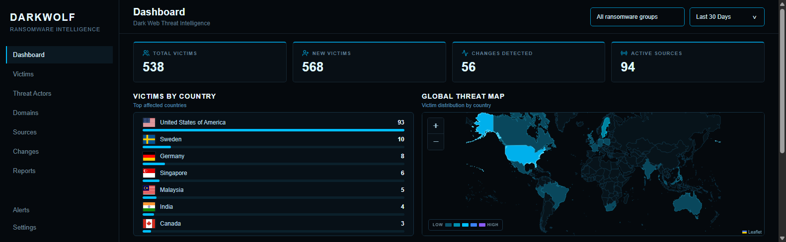
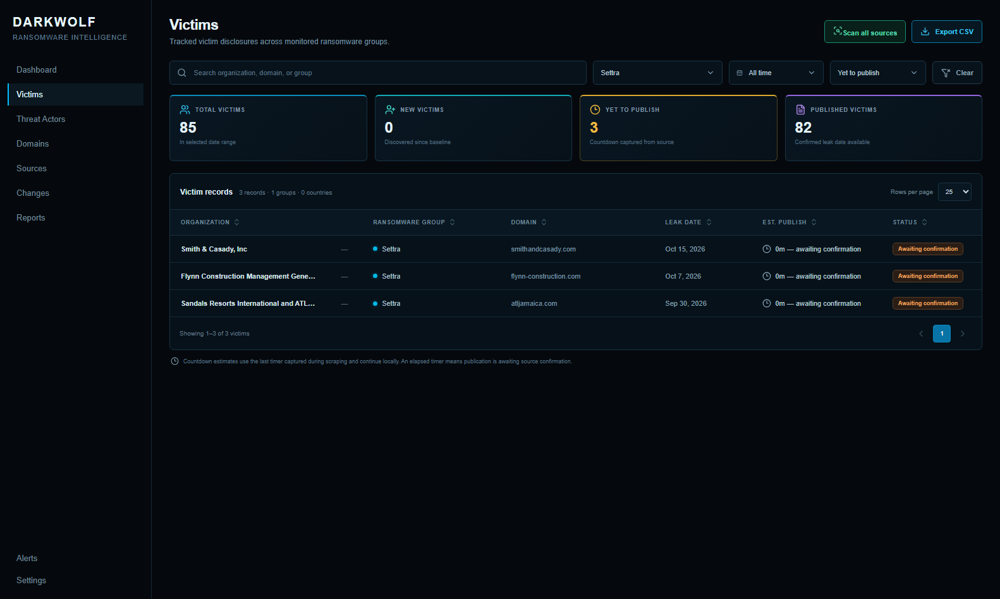
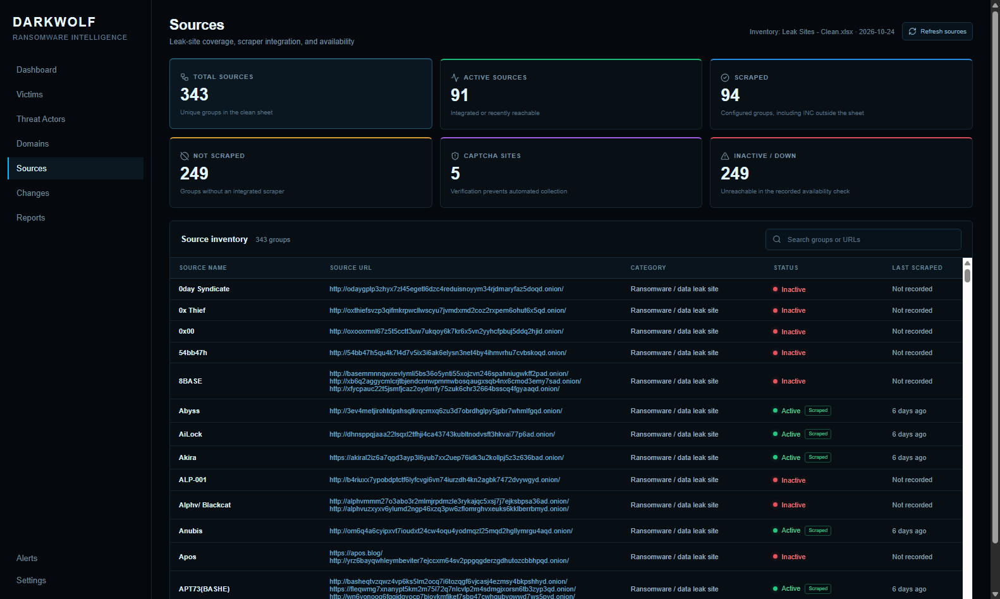
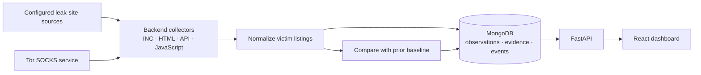

# DarkWolf V2

DarkWolf V2 is a local threat intelligence platform for monitoring ransomware and data leak site announcements. It collects listing metadata from configured sources, stores normalized victim observations and collection evidence in MongoDB, compares successive observations to identify changes, and presents the results in a React dashboard.

The project has a **FastAPI + MongoDB backend** and a **React + TypeScript frontend**. Live collection runs from the Windows machine and uses its Tor SOCKS connection for onion sources.

## Screenshots

These screenshots show a local data snapshot captured on November 9, 2026. Counts and source availability change as collection runs complete.

### Dashboard

The dashboard summarizes victims, new entries, detected changes, active sources, country distribution, and the global threat map.



### Victims

The victims page supports search, group/date/status filters, publication state and timer fields, CSV export, and starting the complete scrape cycle.



### Sources

The sources page summarizes the inventory and shows each unique source, its URL, scrape status, category, and last scrape time.



## What it does

- Collects listings through the configured INC, HTML, API, and JavaScript-driven source collectors.
- Extracts normalized organization names, domains, countries, leak dates, publication state, countdown metadata, and other available listing fields.
- Stores collection observations and evidence in MongoDB for later review.
- Compares new observations with prior baselines to detect newly listed victims and material listing changes.
- Exposes dashboard, victim, source, change, evidence, and scrape-control APIs.
- Shows metrics, country counts, a world map, source inventory, recent victims, and changes in the frontend.
- Continues captured countdowns locally using the last observed timer and capture time; it does not need to keep the source page open for that timer display.

## Architecture



## Repository layout

| Path | Contents |
| --- | --- |
| `darkwolf-backend/app/` | FastAPI service, MongoDB access, models, change detection, collection code, and source registries |
| `darkwolf-frontend/` | React, TypeScript, and Vite dashboard |
| `run_full_scrape.ps1` | Windows full-cycle runner with MongoDB and Tor SOCKS preflight checks |
| `requirements.txt` | Pinned Python dependencies for the backend and root utilities |
| `darkwolf-frontend/package-lock.json` | Locked frontend dependency tree |
| `darkwolf-backend/app/data/source_inventory.json` | Source inventory used by the backend |
| `recon/` | Source inspection utilities, inventory snapshots, and maintained investigation material |
| `Captchy/`, `Insomnia/`, `Storm/` | Separate experimental browser/captcha tooling and its dependencies |
| `darkwolf-backend/.env.example` | Safe template for local backend configuration |

## Requirements

- Windows 10 or later for the supplied PowerShell scrape-cycle script.
- Python 3.11 or later.
- Node.js 20.19+ or 22.12+ and npm. The frontend uses Vite 8.
- MongoDB available at `127.0.0.1:27017`, or a configured MongoDB URI.
- A Tor SOCKS listener for live onion collection. Common local ports are `9150` for Tor Browser and `9050` for a standalone Tor service.

The frontend currently calls the API at `http://127.0.0.1:8000`; the development server normally runs at `http://127.0.0.1:5173`.

## Setup

### 1. Clone the repository

```powershell
git clone https://github.com/leescripts-dev/DarkWolf-v2.git
Set-Location DarkWolf-v2
```

### 2. Start MongoDB and Tor

Install MongoDB Community Server and start the MongoDB service. Confirm MongoDB is reachable before starting the backend. If the service is configured locally, Windows Services can be used to start **MongoDB Server**.

Start Tor Browser or the standalone Tor service and confirm its SOCKS listener is running. The full scrape script checks MongoDB and tries the configured SOCKS port, then the common local alternatives.

### 3. Configure and install the backend

From the repository root, in PowerShell:

```powershell
py -3 -m venv darkwolf-backend\.venv
darkwolf-backend\.venv\Scripts\python.exe -m pip install --upgrade pip
darkwolf-backend\.venv\Scripts\python.exe -m pip install -r requirements.txt
Copy-Item darkwolf-backend\.env.example darkwolf-backend\.env
```

Edit `darkwolf-backend/.env` and replace the two `INC_RANSOM_*` example URLs with the correct source URLs for your environment. The template also documents the MongoDB and Tor settings:

```dotenv
INC_RANSOM_URL=https://your-inc-source/
INC_RANSOM_API_BASE_URL=https://your-inc-api/
MONGO_URI=mongodb://127.0.0.1:27017
MONGO_DB=darkwolf
TOR_HOST=127.0.0.1
TOR_SOCKS_PORT=9150
```

The backend reads settings from environment variables and `darkwolf-backend/.env`. Local `.env` files are ignored by Git.

### 4. Start the backend

In a PowerShell window:

```powershell
Set-Location darkwolf-backend
.\.venv\Scripts\python.exe -m uvicorn app.main:app --reload --host 127.0.0.1 --port 8000
```

Check the service and database connection:

- API health: <http://127.0.0.1:8000/health>
- MongoDB health: <http://127.0.0.1:8000/health/database>
- Interactive API docs: <http://127.0.0.1:8000/docs>

### 5. Install and start the frontend

In a second PowerShell window, from the repository root:

```powershell
Set-Location darkwolf-frontend
npm ci
npm run dev
```

Open <http://127.0.0.1:5173>.

## Run a full scrape cycle

With MongoDB, the backend configuration, and Tor SOCKS available, run the script from the repository root:

```powershell
.\run_full_scrape.ps1
```

The runner performs a preflight, then runs the collection stages in order:

1. INC Ransom
2. HTML leak sites
3. API leak sites
4. JavaScript-driven leak sites

Stage logs are written to `darkwolf-backend/logs/full-scrape-<timestamp>/`. If a source fails, the remaining stages still run and the summary reports the failed stage.

To resume at a stage or change INC pagination size:

```powershell
.\run_full_scrape.ps1 -StartAt api-leak-sites
.\run_full_scrape.ps1 -PerPage 25
```

The available `-StartAt` values are `all`, `inc-ransom`, `html-leak-sites`, `api-leak-sites`, and `javascript-leak-sites`.

## API overview

The FastAPI application exposes these main endpoints under `/api/v1`:

| Endpoint | Purpose |
| --- | --- |
| `GET /dashboard/metrics` | Dashboard metrics; accepts range and group filters |
| `GET /dashboard/countries` | Victim counts by country |
| `GET /dashboard/groups` | Available ransomware groups |
| `GET /victims` | Searchable, filterable and paginated victim observations |
| `GET /victims/recent` | Recent victim entries for dashboard widgets |
| `GET /changes` | Detected changes, with filtering and pagination options |
| `GET /sources` | Source inventory and current status summary |
| `POST /scrape/start` | Start the complete collection cycle from the UI |
| `GET /scrape/status` | Current and most recent collection status |

The frontend expects the API at `http://127.0.0.1:8000` in the current development configuration. The FastAPI CORS configuration currently allows the local Vite origins.

## Python dependencies

The root `requirements.txt` is the pinned backend/root-utilities dependency list. The frontend uses `package.json` and `package-lock.json`; use `npm ci` to install the locked versions. `Captchy/requirements.txt` is only for the separate experimental Captchy tooling and is not needed for the main app.

## Troubleshooting

- **Backend will not start:** check that `darkwolf-backend/.env` exists and both required `INC_RANSOM_*` values have been set.
- **MongoDB health is false:** start MongoDB and confirm `MONGO_URI` points to the running instance.
- **Scrape preflight reports Tor unavailable:** start Tor Browser or the standalone Tor service and set `TOR_SOCKS_PORT` to its SOCKS listener, commonly `9150` or `9050`.
- **Frontend loads without data:** confirm the API responds at `http://127.0.0.1:8000/health/database` and that the frontend is using the configured local API address.
- **A scrape stage reports source errors:** inspect that stage's log in `darkwolf-backend/logs/full-scrape-<timestamp>/`; one source timing out does not prevent later stages from running.

## Git hygiene

The root and component `.gitignore` files exclude local secrets, virtual environments, Python caches, `node_modules`, build output, logs, and the `debug/` scratch directory. Keep credentials and session data in local environment files, never in committed source or README examples.
